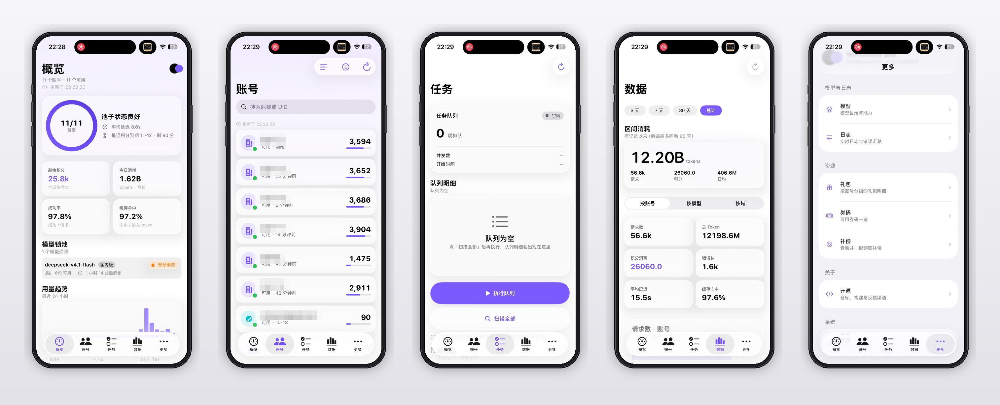

# WB2API iOS

> **最新安装包**：[WB2API-unsigned.ipa（1.3.0 · build 35）](https://github.com/chenyynx/wb2api-ios/releases/latest/download/WB2API-unsigned.ipa)
> 未签名 IPA，需用全能签 / SideStore / AltStore 等工具重签后安装。

[](https://github.com/chenyynx/wb2api-ios/actions/workflows/ci.yml)


[](https://github.com/chenyynx/wb2api-ios/releases/latest)

[workbuddy2api-panel](https://github.com/misakano7545/workbuddy2api-panel) 的原生 iOS 客户端，用于在手机上完成账号池日常运维：状态巡检、任务自动化、用量与日志查询、配置变更。

应用不直接访问上游服务，全部读写经由面板提供的 HTTP API 完成，鉴权使用面板的 `api_key`。

## 界面

<p align="center">
  
</p>

<p align="center">
  <sub>概览 · 账号池 · 任务队列 · 用量统计 · 更多（截图内账号信息已脱敏）</sub>
</p>

## 功能范围

| 模块 | 能力 |
|---|---|
| 概览 | 池健康度与关键指标、模型限流状态、批量签到 / 巡检 / 活跃上报 / 保活、24 小时用量趋势（可逐小时查看） |
| 账号 | 搜索与筛选、状态与恢复倒计时、周期刷新、账号详情（额度、模型成本、到期、最近错误）、单账号操作（签到、余额、旅行、暂停、禁用、复活、移除）、按账号启停模型 |
| 任务 | 扫描成长任务、按账号 / 按任务勾选执行、执行队列状态与逐项明细、暂停队列、单任务完整执行（接受 → 执行 → 回读校验 → 领奖） |
| 数据 | 用量区间统计（3 天 / 7 天 / 30 天 / 全部）、按账号 / 模型 / 域聚合、积分历史、余额趋势 |
| 模型 | 模型目录与能力字段、探测结果 |
| 日志 | 实时日志流（系统 / 对话 / 任务）、请求指标、错误汇总 |
| 资源 | 礼包明细、券码、补偿领取 |
| 系统 | 面板配置读写（表单 + JSON）、扫码授权登录、API Key 添加账号、Cockpit 账号导入、服务器与密钥管理 |

## 架构

```
WB2API/
├─ Core/          网络层、数据模型、会话与凭据、格式化
├─ Design/        间距、圆角、动效参数
├─ Components/    可复用视图（卡片、错误条、状态标签等）
└─ Features/      按功能分区：Overview / Accounts / Tasks / Data / Models / Logs / Packages / Config / Login / Settings
```

- **网络**：`APIClient` 是唯一出口，统一拼接 `/panel/api` 前缀、注入 `Authorization: Bearer <api_key>`、把 401 映射为密钥失效、对慢接口（单任务、扫描、批量、余额）单独放宽超时。
- **数据模型**：`Codable` 模型与后端 JSON 一一对应（`convertFromSnakeCase`），解码失败的字段显式暴露而不是静默丢弃。
- **状态管理**：`@Observable` + 通用 `Loader`，统一 `isLoading / error / value` 三态；取消（页面切换、下拉刷新打断）不视为错误。
- **刷新策略**：概览与账号页按固定间隔静默轮询；回到前台、下拉、点击刷新都会强制重发；详情页打开期间暂停列表轮询。
- **凭据**：`api_key` 存 Keychain，服务器地址存 UserDefaults；不落日志、不上报。

## 后端契约

客户端依赖面板的路由注册（`internal/panel/panel.go`），路径前缀为 `/panel/api`，鉴权头为 `Authorization: Bearer <api_key>`。面板需要把 `/panel/` 前缀反向代理到同一来源，App 不做跨域处理。

对接时注意：

- 慢接口：`accounts/{uid}/tasks/auto`（单任务，最多 180s）、`tasks/scan_all`（120s）、`*_all` 批量操作（180s）、`balance_all`（90s）；
- `config` 的 `POST` 接收完整配置对象本身（不是 `{config: ...}` 包装），返回 `restart_required` 字段；
- `accounts/{uid}/model_toggle` 的关闭字段是 `off`（`true` 表示关闭）；
- `import/cockpit` 需要 multipart 的 `file` 字段。

模型与真实响应的字段对拍脚本见 `tools/check_models.py`。

## 环境要求

- macOS + Xcode 26 或以上（部署目标 iOS 26.0，使用 iOS 26 SDK 的 API）
- [XcodeGen](https://github.com/yonaskolb/XcodeGen)
- 可访问面板的 iPhone（iOS 26+）

## 构建

工程文件由 XcodeGen 生成，仓库不提交 `.xcodeproj`：

```bash
brew install xcodegen
xcodegen generate
open WB2API.xcodeproj
```

命令行构建与测试：

```bash
xcodebuild test -project WB2API.xcodeproj -scheme WB2API \
  -destination 'platform=iOS Simulator,name=iPhone 16 Pro'
```

## 测试

- 单元测试约 45 个，覆盖模型解码（基于真实响应的脱敏夹具）、格式化、`APIClient`（鉴权头、401 映射、错误分型、取消处理）、展示层字段映射与任务执行器。
- 夹具由 `tools/sanitize_fixtures.py` 从脱敏后的抓包响应生成，仓库不含真实凭据。
- 字段对拍：`python3 tools/check_models.py`，将 Swift 模型与接口响应对齐，用于发现键名或类型漂移。

## CI 与分发

- 最新安装包：[Releases](https://github.com/chenyynx/wb2api-ios/releases/latest)（未签名 IPA，重签后安装）。
- 每次推送触发两条流水线：模拟器单元测试、无签名 IPA 构建。
- 产物在 Actions 页面的 `WB2API-unsigned-ipa` artifact 中，使用全能签 / SideStore / AltStore 等工具重签后安装。
- Bundle ID：`org.example.wb2api`。

## 目录外的辅助脚本

| 脚本 | 用途 |
|---|---|
| `tools/check_models.py` | 模型与真实响应逐字段对拍 |
| `tools/sanitize_fixtures.py` | 生成脱敏测试夹具 |
| `tools/ci_errors.py` | 从 CI 日志提取编译错误 |
| `tools/make_icon_dog.py` | 由 Phosphor 图标生成 App 图标 |

## 安全与隐私

- 凭据只存本机 Keychain；仓库、测试夹具、CI 日志均不含明文密钥。
- 应用仅与你自行部署的面板通信，不包含统计、埋点或第三方 SDK。
- 移除账号、禁用账号、批量操作等写操作需二次确认，避免误触。

## 参与贡献

- 提交前请确保 `xcodebuild test` 通过；CI 会对推送和 PR 执行同样的检查。
- 代码约定：一类型一文件；`body` 中不写业务逻辑，抽成独立视图或方法；不使用强制解包；异步任务需处理取消。
- 提交信息使用祈使句，说明改动原因而不是罗列文件。

## 相关项目

- [workbuddy2api-panel](https://github.com/misakano7545/workbuddy2api-panel)：后端面板，账号池网关与运维界面，本 App 的服务端。

## 许可与素材

- 代码：[MIT](LICENSE)
- App 图标：改编自 [Phosphor Icons](https://github.com/phosphor-icons/core) 的 `dog-fill`（MIT），生成脚本 `tools/make_icon_dog.py`
